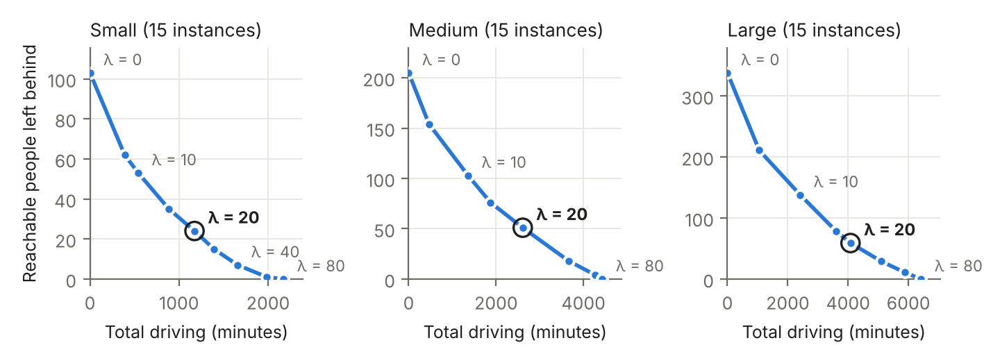
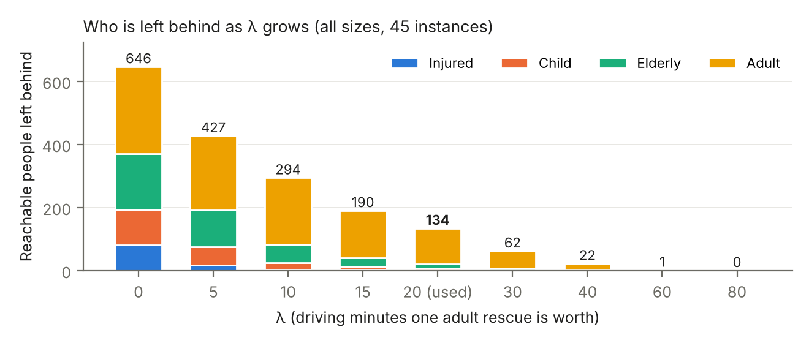
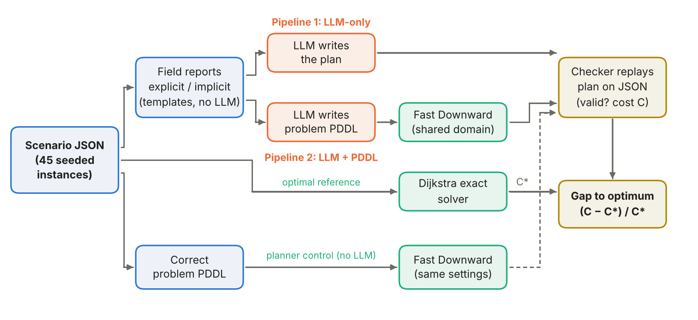

# 1. Introduction

**Flood rescue and AI for good.** Monsoon floods and landslides in Nepal regularly wash out roads and bridges and leave villages cut off. In the first hours of a response, coordinators must turn scattered field reports ("the bridge at Belkot is gone", "an elderly couple is still at the temple") into a plan: which vehicle goes where, who is picked up first, and who has to wait for the next wave. This is planning under hard constraints, and mistakes cost lives. It is a natural test case for the question this project asks: should a frontier language model make the plan itself, or should it translate the situation into a formal model that a planner solves?

**The subproblem we study.** We use a deliberately simplified version of the problem. A known road network has travel times and some damaged roads that cannot be used. Cars with a fixed number of seats start at known places. Civilians wait at locations and fall into four priority bands: injured, children, elderly and adults. A plan drives cars along roads, loads people, and unloads them at evacuation points. Anyone not rescued must be explicitly *deferred* to a later wave, at a penalty that depends on their band. The aim is to minimise driving time plus deferral penalties. This is a cost-optimal classical planning problem [@mcdermott1998pddl] and a shortest-path search over a large state space [@dijkstra1959; @hart1968astar]. The input arrives in natural language, so it also tests language understanding. We leave out much of real disaster response: travel-time uncertainty, roads that change during the operation, deadlines and medical deterioration over time, vehicle types other than cars, fuel, and communication between teams (Section 5.1).

**Research questions.** Recent work suggests that LLMs plan poorly on their own but can translate problems for a sound planner [@liu2023llmp; @valmeekam2023planbench; @kambhampati2024llmmodulo]. We test this claim on rescue planning with current Claude models, using two linked questions:

- **Area A (pipeline performance).** Under matched conditions, when does *LLM-only* planning or *LLM + PDDL* planning give better valid rescue plans, measured by validity and gap to a proven optimum?
- **Area B (translation versus search).** How faithfully does the LLM translate reports into PDDL, and are the PDDL pipeline's shortfalls due to translation errors or to the planner's configuration and time budget?

We treat report style (explicit or implicit), scenario size and model as analysis dimensions. Section 4.1 answers Area A, Section 4.2 answers Area B, and Section 6 summarises both.

# 2. Problem Formulation and Benchmark

## 2.1 Rescue formulation

**Instances and plans.** An instance consists of a road graph *G* = (*V*, *E*), where each road has a travel time *t*(*e*) in minutes and may be damaged; a set *V*~E~ ⊆ *V* of evacuation points; cars, each with a start location and *Q* = 4 seats; and the number of people of each band *b* ∈ {injured, child, elderly, adult} waiting at each location. A plan is a sequence of `drive`, `load`, `unload` and `defer` actions. The world is fully known and static during planning: road status, travel times and head counts do not change, and the report contains every fact needed. These assumptions make the comparison exact (every instance has one correct answer that we can check) but are the main source of lost realism. Table 1 lists the state and our reasons for each modelling choice.

**Table 1. State variables and modelling assumptions**

| Element | Representation | Assumption and justification |
|---|---|---|
| Locations and roads | `location` objects; `(road a b)` in both directions, `(damaged a b)`, numeric `(travel-time a b)` | Damaged roads are simply unusable, and travel time is fixed. Field reports usually say *whether* a road is passable, not how slow it is. |
| Vehicles | `(car-at c l)`, `(free-seats c n)`, `(carrying c b n)` | One vehicle type with 4 seats. Cars move independently and need not return to base. |
| Civilians | `(waiting l b n)`: number of people of band *b* at *l* | People are counted, not named, so a group at one place can be split across cars and trips. An injured person counts only as injured, whatever their age. |
| Goal and cost | Every `waiting` and `carrying` count reaches zero; `total-cost` fluent | The plan *accounts* for everyone (rescued or deferred). It does not have to rescue everyone. |

**Actions.** Counts are numbers, but classical PDDL has no arithmetic in preconditions. We therefore represent counts by level objects `n0 … nK` with a static relation `(sum a b c)` meaning *a* + *b* = *c* and a predicate `(positive n)`. Table 2 gives the four actions.

**Table 2. Action semantics**

| Action | Preconditions | Effects and cost |
|---|---|---|
| `drive c a b` | car at *a*; road *a*–*b* exists and is not damaged | car moves to *b*; cost *t*(*a*, *b*) |
| `load c l b m` | car at *l*; *m* > 0 people of band *b* waiting at *l*; *m* ≤ free seats | waiting count −*m*, carrying count +*m*, free seats −*m*; cost 0 |
| `unload c l b` | car at *l*; *l* is an evacuation point; car carries *k* > 0 of band *b* | carrying count set to 0, free seats +*k*; cost 0 |
| `defer l b` | *w* > 0 people of band *b* waiting at *l* | waiting count set to 0; cost *w* · *p*~*b*~ |

**Constraints and completion.** Seat capacity is enforced through `free-seats`, and damaged roads through the `drive` precondition. People are conserved: every person is always waiting, in exactly one car, rescued or deferred. The goal requires every `waiting` count and every `carrying` count to be zero. A plan is therefore complete when everyone is either delivered to an evacuation point or deferred, which is weaker than rescuing everyone: deferring is legal but costly. Cars do not have to end at a shelter, but because a car must be empty at the end, any passengers must be unloaded at an evacuation point.

## 2.2 Objective and modelling choices

**Objective.** The planner minimises

*C*(π) = *T*~drive~(π) + Σ~*b*~ *p*~*b*~ · *D*~*b*~(π),

where *T*~drive~ is the total driving time of all cars in minutes and *D*~*b*~ is the number of people of band *b* deferred. Following the compilation of soft goals into action costs [@keyder2009soft], each penalty is measured in minutes of driving. The implemented penalties, checked against the domain, the generator and the checker, are injured 80, child 60, elderly 50 and adult 20 minutes per person. This cost is what all methods optimise and what we score. Rescue coverage (how many people, and which bands, were rescued) is reported separately, because two plans of equal cost can rescue different people.

**Choosing the penalties.** We write each penalty as *p*~*b*~ = λ · *r*~*b*~. The urgency weights *r*~*b*~ = 4, 3, 2.5 and 1 (injured, child, elderly, adult) fix the *order* of priority, following triage practice, relative to an adult. The scale λ is an exchange rate: how many driving minutes it is worth spending to rescue one adult now rather than leave them for the next wave. We use λ = 20, which gives the penalties above. These numbers are modelling choices for an experiment, not a valuation of human lives (Section 5.2).

λ decides what kind of problem the benchmark poses. At λ = 0 deferring is free and the best plan defers everyone. For large λ deferring is never worth it, and the problem becomes pure vehicle routing with no triage left. To choose λ we re-solved all 45 instances optimally (with the solver of Section 3.3) for ten values of λ between 0 and 120, keeping *r*~*b*~ fixed. Figure 1 shows the resulting trade-off. λ = 20 lies in the middle of the curve for every size. Its plans rescue 512 of the 646 people a car can reach (79%) using 60% of the driving needed to rescue all of them, so the instances still require real decisions about who to leave behind. Those decisions follow the intended priorities (Figure 2): of the 134 reachable people left behind, 113 are adults, 13 elderly, 7 children and 1 injured. Extra rescues also get more expensive along the curve. Raising λ from 10 to 20 rescues 160 more people at about 22 extra driving minutes each, while raising it from 20 to 40 rescues 112 more at about 35 minutes each. All main results use λ = 20; other values appear only in this analysis.

{width=6.3in}

{width=5.6in}

**PDDL specification.** The domain file is shared and fixed. It declares the types `location`, `car`, `band` and `level`; the four band names and `n0` as constants; the predicates of Table 1; the numeric functions `travel-time`, `defer-cost` and `total-cost`; and the four actions. It uses only `:strips`, `:typing`, `:negative-preconditions` and `:action-costs` [@mcdermott1998pddl], all of which Fast Downward supports [@helmert2006fd]. Each problem file supplies the objects, the roads with their travel times and damage, the evacuation points, car positions and seats, waiting counts, the `sum` and `positive` tables up to the largest count, the `defer-cost` values, the goal, and `(:metric minimize (total-cost))`. Only the problem file changes from instance to instance.

**Splittable versus no-split groups.** Our first formulation forced each group at a location to travel together. The final model counts people per location and band, so a group can be split across cars and trips, as rescuers would in practice. On the 37 instances where the no-split optimum is proven, splitting gives a strictly cheaper optimum on 8, saving up to 15% (large-13: 212 instead of 250; medium-08: 280 instead of 314). It also makes optimal search harder: Fast Downward proved 15 of 15 medium and 7 of 15 large no-split instances optimal within 300 s, against 14 and 5 for the splittable model. All results in this report use the splittable model.

## 2.3 Scenarios and report construction

**Instances.** `generate.py` builds 45 instances, 15 per size, from fixed seeds, so the same seed always gives the same instance. Place names come from the Nuwakot, Rasuwa and Dhading districts of Nepal, but the maps are synthetic. Locations are placed at random on a 60 × 60 km grid and joined by a random spanning tree plus some short extra roads. Travel time is about one minute per kilometre, reflecting slow flood-damaged roads, and a fixed share of roads is marked damaged. Each non-evacuation location has a kind (school, village, care home, farm, temple or market) that sets the mix of bands found there, for example mostly children at a school and mostly elderly people at a care home. About 10% of people are injured. Fifteen instances per size balances coverage against the cost of running every instance with three models, two report styles and two pipelines. The instances are designed to be varied and to stress triage and routing; they are not samples of real incidents.

**Table 3. Scenario composition (ranges over the 15 instances of each size)**

| Size | Scenarios / reports | Locations | Roads (damaged) | Cars / evac. points | People (unreachable) | Location–band groups |
|---|---|---|---|---|---|---|
| Small | 15 / 30 | 5–6 | 5–7 (0–3) | 1 / 1 | 4–12; 119 total (16) | 2–4 |
| Medium | 15 / 30 | 7–9 | 9–12 (0–5) | 1–2 / 1–2 | 9–20; 239 total (34) | 4–7 |
| Large | 15 / 30 | 10–14 | 14–20 (2–8) | 2 / 2 | 17–31; 362 total (24) | 6–11 |

Larger instances are harder for more reasons than size. They have two cars, which must share the work and multiply the number of ways to assign people. They have more populated sites, so a full car must make several trips and the order of trips matters. And they have more damaged roads, so cheap-looking routes may be unusable.

**From facts to reports.** Every field report is generated from the instance's JSON by deterministic templates in `reports.py`. No LLM was used to write or edit reports. Each instance gets two reports with the same facts:

- **Explicit** reports state facts plainly: "Naukunda shelter [naukunda-shelter] ↔ Benighat farm [benighat-farm]: 11 min, IMPASSABLE (damaged)" and "Likhu school [likhu-school]: 3 adults".
- **Implicit** reports phrase the same facts the way a journalist might, so the model must infer them: "A landslide has buried the road between Naukunda shelter [naukunda-shelter] and Benighat farm [benighat-farm] (normally a 11-minute drive)" and "three men and women from the cooperative waiting for help". They also add harmless distractors, such as "muddy but passable" roads and a school on high ground that "the authorities have not designated as a place to bring people".

Each location and car keeps a bracketed identifier in both styles, so plans can name them unambiguously, and travel times are always given. The template wording for each fact is chosen by a random generator seeded with the instance and style, so reports are reproducible.

**Consistency checks.** The JSON file is the single source of truth: the reports, the problem PDDL and the checker are all generated from it. Our plan checker replays a plan against the JSON and is written independently of the PDDL domain. On all 45 Fast Downward reference plans it agrees with VAL [@howey2004val] on validity and cost, which ties the PDDL model to the JSON semantics. Translations give evidence that both report styles carry the full facts: Opus and Sonnet reproduced the exact benchmark problem encoding from all 90 reports, explicit and implicit. One shared-source risk remains: if the generator itself encoded a rescue rule wrongly, every component would agree and still be wrong. Writing the checker separately from the domain, and reviewing both against the task rules given to the models, reduces this risk but does not remove it.

# 3. Methods and Experimental Setup

{width=6.4in}

## 3.1 Compared pipelines

**Shared task rules.** Both pipelines receive the same field report and the same description of the operation: the road, capacity, drop-off and deferral rules, the penalties, and the objective (Figure 3). Neither receives the ground-truth JSON, the correct problem PDDL, reference plans, optimal costs or fidelity scores. The prompts differ only in what they ask the model to produce.

**LLM-only: report → model → plan.** The model writes the plan directly, one action per line inside `<plan>` tags, followed by its own claimed cost. The first `<plan>` block is parsed and replayed by the checker. Each report was sent once to each model, with no repair (run 2 of the direct pipeline, saved under `pipelines/runs/rerun-*`). An unparseable or illegal plan counts as invalid.

**LLM + PDDL: report → model → problem PDDL → planner → plan.** The model is given the shared domain and asked to write only the problem file. Fast Downward then searches for a cost-optimal plan, which is replayed by the same checker. This splits the work between the model's language understanding and the planner's systematic search, which the model cannot do itself [@liu2023llmp]. The weakness is that a valid plan for a *mistranslated* problem (for example, a damaged road left out) can still be wrong or unsafe in the real world.

**What the model generates and what is fixed.** The model must generate the objects, initial facts (roads, damage, travel times, evacuation points, cars, waiting counts, the `sum`/`positive` tables and `defer-cost` values), the goal and the metric. The domain (types, predicates and actions) is fixed. This isolates *problem translation*: every difference between pipelines comes from reading the report or from search, not from the model inventing its own action model.

**Extraction and failure handling.** The PDDL is taken from the `pddl` code block in the response. Fast Downward's translator then parses and grounds it. We distinguish five failure stages: malformed or unsupported PDDL (rejected by the translator), unsolvable problems, search that times out without a plan, plans that fail the ground-truth checker, and valid but suboptimal plans. The full experiment used no repair loop: one model call per case.

## 3.2 Planner configuration and justification

In the PDDL pipeline, Fast Downward (commit `ed3d389`) first runs A\* with the admissible LM-cut heuristic [@hart1968astar; @helmert2009lmcut] for 60 CPU seconds. If that ends without a plan, it runs the anytime satisficing configuration `seq-sat-lama-2011` [@richter2010lama] for another 60 CPU seconds and keeps the best plan saved so far, even on timeout. Each search subprocess has a 120-second wall-clock guard, and planner jobs ran one at a time so that runs did not compete for CPU.

The optimal search comes first because, when it finishes, its plan is provably optimal *for the generated problem*. LAMA is the fallback because it reliably finds *a* valid plan quickly but gives no optimality guarantee. The 60 + 60 s budget is a practical choice for 270 cases plus controls, not a tuned configuration; we did not run a comparative tuning study. Note the difference from our reference solves (Section 3.3), which used 300 s per search and also tried merge-and-shrink. Within this budget, "the planner returned a plan" means a feasible plan, not necessarily an optimal one.

## 3.3 Experimental setup, optimal reference and planner control

**Controlled conditions.** Both pipelines use the same 90 reports, the same three models (`claude-opus-5-5`, `claude-sonnet-5-5` and `claude-haiku-5-5`), medium reasoning effort, one attempt and zero repairs. All calls went through the Claude Code CLI (`claude -p`) on a subscription, with tools disabled, no settings files, no saved conversation and an empty working directory, so the model saw only the prompt. Temperature was left at the provider default; it was not set or measured. The prompts necessarily differ by task (write a plan, or write a problem file).

**Why PDDL and Fast Downward.** Our model needs typed objects, negative preconditions and action costs with a cost-minimising metric. Fast Downward supports all of these and offers both optimal and satisficing search in one system [@helmert2006fd]. This mirrors the LLM-to-PDDL set-up of prior work [@liu2023llmp]. An integer programming or vehicle-routing formulation [@talarico2015ambulance] would fit the problem but would require the LLM to write a less standard and less checkable specification; we discuss such alternatives in Section 5.1.

**Evaluation routes.** *Route A* replays every plan from both pipelines with the same JSON checker and compares its cost *C* with the optimum *C*\* from our exact solver. The gap is (*C* − *C*\*) / *C*\* × 100%. *Route B* compares each generated problem file with the correct one, fact by fact, then compares their plans under identical Fast Downward settings. The correct-PDDL path is a **planner control**, not an optimal reference. Neither route feeds anything back to the model.

**Correct-PDDL control.** *[Kimaya to expand.]* We ran Fast Downward once on each of the 45 correct problem files, with exactly the same domain and the same 60 + 60 s configuration as the PDDL pipeline, and no report or LLM. Because the input is guaranteed correct, any shortfall here is due to the planner and its budget, which separates search failures from translation errors. The control returned 45 of 45 valid plans, of which 28 were optimal.

**Dijkstra reference solver.** To measure a gap we need the optimum of every instance. Fast Downward's optimal searches (A\* with LM-cut, then merge-and-shrink [@helmert2014ms], 300 s each) proved only 34 of the 45 instances optimal: all 15 small, 14 medium and 5 large. On the other 11, the best plans it found were 17–88% above the optimum. The difficulty is the encoding. The `load` action has ten parameters and grounds to many actions; the same rescues can be reached by many orders of loads, drives and car assignments; and under the delete relaxation a car keeps every seat count it has ever had, so LM-cut ignores capacity and the repeated trips that dominate the cost of large instances.

We therefore wrote `exact.py`, a uniform-cost (Dijkstra) search [@dijkstra1959] over a reduced state space built directly from the JSON, not from PDDL. Shortest paths *d*(*u*, *v*) on undamaged roads are precomputed. A state is (*c*, *pos*, (*n*~*v*~)~*v*~): the car currently being planned, its position, and how many people have been taken from each site *v*. There are three kinds of transition. A *trip* takes car *c* from *pos* through a set *S* of sites (|*S*| ≤ 4, best visiting order) to an evacuation point *e*; it costs its driving and adds the people picked up to *n*~*v*~. A *hand-over* to car *c* + 1 costs 0. A final *defer* step, after the last car, costs the penalties of everyone left and ends the search. All costs are non-negative, so the first time Dijkstra reaches the end, its cost is optimal for the reduced problem. Five reductions make the reduced problem's optimum equal the original one:

1. *Shortest paths:* between two stops a car should follow a shortest path.
2. *Trips:* unloading is free, only possible at evacuation points, and cars must end empty, so every route is a sequence of trips that each end at an evacuation point.
3. *Cars one at a time:* there is no clock and the cost is a sum, so any joint plan can be reordered to run car 1's trips first, then car 2's, at the same cost.
4. *Most urgent first:* at a site, taking a higher-penalty person instead of a lower one never raises the cost, so only the number taken per site matters, taken in decreasing penalty order.
5. *Full cars:* taking one more person on a trip that already visits their site adds no driving and removes a penalty, so each trip carries min(4, people available at its sites).

Each reduction is an exchange argument: it turns any plan into a plan of the reduced form whose cost is no higher, so the optimum carries over to the original formulation. Cross-checks: `exact.py` returns exactly Fast Downward's cost on all 34 instances Fast Downward proved optimal, and all 45 of its plans pass the checker with the claimed cost. Replaying a plan checks its validity and cost; it does not by itself prove the reductions complete, which is why the exchange arguments and the 34-instance agreement matter. All 45 instances solve in about 3.6 minutes in total on one core (the largest search reaches 242,399 states). The solver is domain-specific: its reductions fail if the model gains a clock, different seat types or an unloading cost, so it is an evaluation tool, not a competitor to the general planner.

**Experimental procedure and matrix.** The scenario and report pairs were fixed before any model call. Each pipeline was run on 45 scenarios × 2 report styles × 3 models = 270 cases, that is 30 cases per size per model. The planner control has 45 runs, one per scenario. The 270 cases are paired presentations of 45 scenarios, not 270 independent scenarios: the explicit and implicit reports of a scenario share every fact. We pair observations by model, scenario and report style. Cost comparisons use only pairs where both plans are valid, and invalid or missing pairs are reported separately. Each case has a single sample, which limits claims about variance. Section 4 analyses the explicit reports (135 cases per pipeline). An earlier API pilot (six scenarios, Opus only, with repairs and a different planner sequence) and run 1 of the direct pipeline are kept separate and are not pooled with these results.

**Validity.** A plan is *valid* if, replayed from the initial JSON state, every action is legal (roads exist and are undamaged, loads fit the free seats and the people are there, unloads happen at evacuation points) and at the end nobody is waiting or still in a car. Parsing successfully, or the planner returning a plan, does not count as validity: only the ground-truth replay does. The checker reports the first illegal action, which lets us classify errors.

**Failures and interruptions.** Malformed outputs, invalid plans and planner runs with no plan stay in every denominator. Network, authentication and usage-limit interruptions are not task failures. They pause the batch, completed cases are checkpointed, and the batch resumes from where it stopped. No failed case was silently dropped or re-run with a different model. In the PDDL runs, successful model responses were cached before planning, so a resumed case did not trigger a new model call.

**Resources.** Each pipeline ran on a team member's own computer through a Claude subscription (Claude Code 2.1.319 for the PDDL runs). *[Wilson/Kimaya: add hardware and OS, the direct-run CLI version, and the model-call timeout.]* Because the two pipelines ran on different machines and possibly different CLI versions, we compare their times only descriptively. Planner time is measured in CPU seconds with the limits above, and the reference and λ solves ran separately in a cloud container.

# References

::: {#refs}
:::
